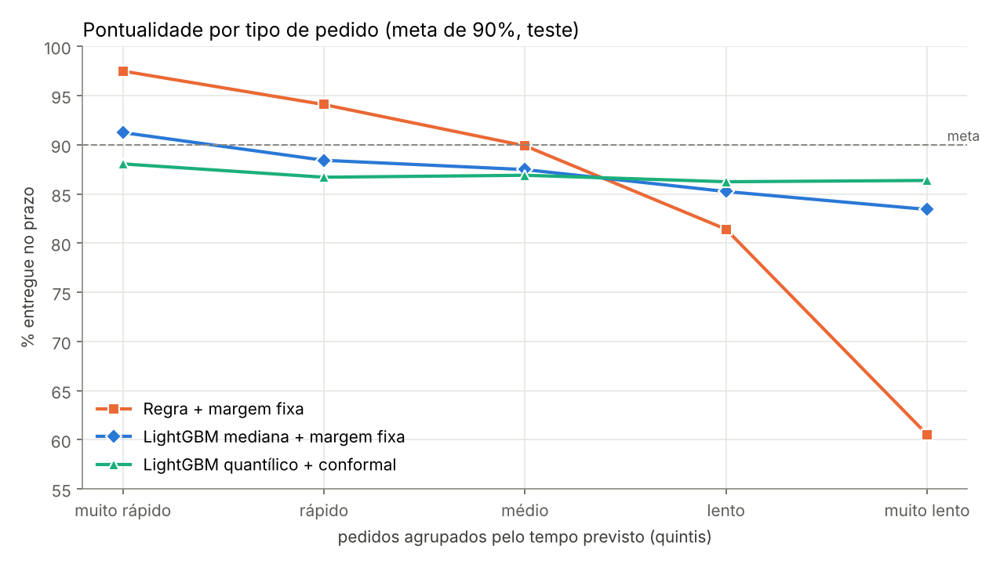
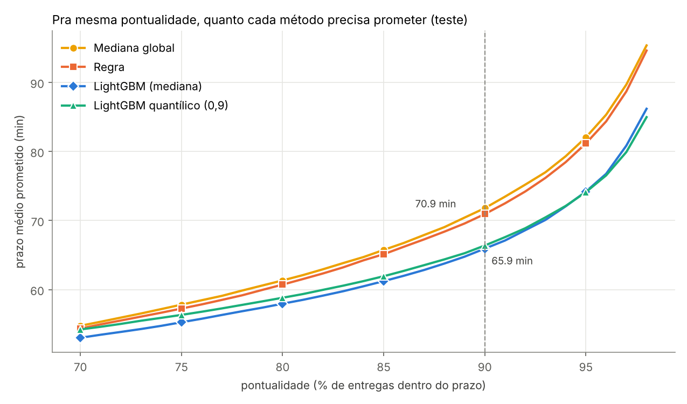
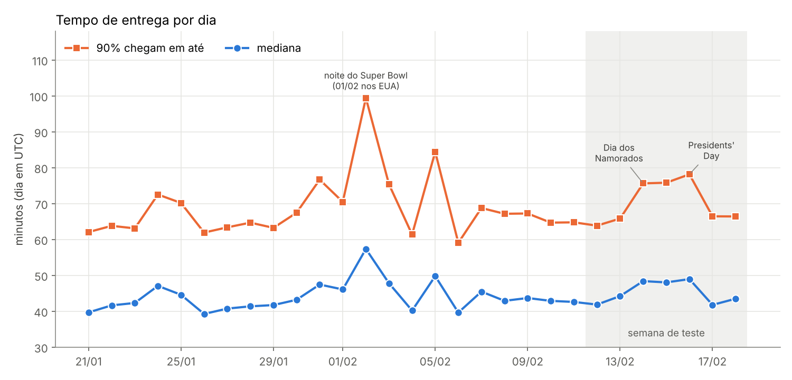
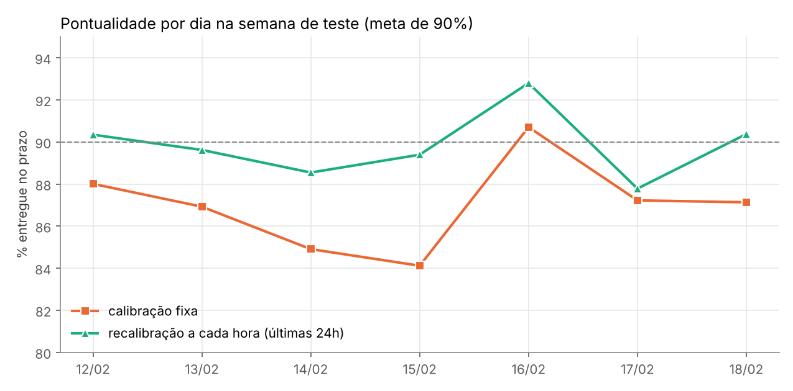

# ⏱️ delivery-eta: quanto prometer no app?

Previsão do tempo de entrega de **197 mil pedidos reais do DoorDash** e escolha do **prazo que aparece pro cliente**. O problema de negócio não é só acertar a média. Se o prazo for curto demais, a entrega atrasa e o cliente reclama. Se for longo demais, o cliente desiste de pedir.

**Demo:** [Space no Hugging Face](https://huggingface.co/spaces/JulioBuzzi/delivery-eta) · **Modelo:** [Hugging Face](https://huggingface.co/JulioBuzzi/delivery-eta)



## Resultados

Semana de teste (12 a 18/02/2015, 50.210 entregas), que nenhum modelo viu no treino e que inclui o Dia dos Namorados e um feriado americano. Meta: 90% das entregas dentro do prazo.

| Método | Pontualidade | Prazo médio prometido | Atraso > 10 min | No prazo, pior tipo de pedido |
|---|---|---|---|---|
| Regra (estimativas da plataforma + margem) | 88,7% | 69,8 min | 5,6% | 70,6% |
| LightGBM mediana + margem | 89,8% | 65,9 min | 4,4% | 86,5% |
| **LightGBM quantílico + conformal** | **89,8%** | **66,4 min** | **4,1%** | **89,1%** |

*Todos os métodos usam a mesma recalibração a cada hora, com as entregas concluídas nas últimas 24h.*

- **Prazo menor com mais pontualidade:** o modelo promete ~3,5 minutos a menos que a regra, chega no prazo com mais frequência e reduz o atraso de mais de 10 minutos de 5,6% pra 4,1%.
- **Risco igual pra todo pedido:** com margem fixa, a regra entrega 98% dos pedidos rápidos no prazo e só 71% dos lentos. O modelo quantílico com conformal mantém de 89% a 91% em todas as faixas, porque a margem cresce onde a incerteza é maior.
- **Previsão pontual:** o LightGBM erra em média **10,3 min**, contra 12,9 da regra (20% a menos).
- **O que mais pesa:** *pedidos na fila por entregador* (oferta × demanda) é a feature mais importante. Na noite do Super Bowl de 2015, a fila chegou a ~2 pedidos por entregador e a mediana passou de 80 minutos.



Pra entregar 90% no prazo, a regra precisa prometer ~71 min em média e o LightGBM ~66 min.

## Metodologia

**Dados:** *DoorDash ETA Prediction*, teste técnico público do DoorDash: 197.428 entregas de 21/01 a 18/02/2015, em 6 mercados dos EUA, com ruído adicionado pela empresa. O alvo é o tempo do pedido até a entrega. Removi 148 registros inválidos (sem horário de entrega, fora do período ou fora de 5–180 min).

**Divisão por data** (nunca aleatória):

| Período | Datas | Uso |
|---|---|---|
| treino | 21/01 – 03/02 | ajustar os modelos |
| validação | 04/02 – 08/02 | early stopping, hiperparâmetros |
| calibração | 09/02 – 11/02 | margem inicial do prazo (conformal) |
| teste | 12/02 – 18/02 | avaliação final |

**Features sem vazamento:** tudo o que usa resultados passados considera **só entregas que já tinham terminado** no momento do pedido:
- **pedido:** itens, valor, preços;
- **loja:** categoria, protocolo, mercado;
- **horário;**
- **oferta × demanda:** entregadores online/ocupados, pedidos na fila, fila por entregador;
- **estimativas da plataforma:** envio pra loja, deslocamento;
- **histórico da loja:** tempo médio das entregas já concluídas, suavizado pra lojas novas;
- **mercado na última hora:** tempo médio das entregas concluídas nos últimos 60 min.

**Modelos:**
- **Regra:** soma as estimativas da plataforma (envio + deslocamento) com um tempo de preparo mediano. É o que um sistema sem ML faria.
- **LightGBM com perda quantílica:** no quantil 0,5 (previsão pontual) e no quantil da meta (0,8 a 0,95).
- **Conformal prediction:** ajusta o quantil previsto pra garantir a pontualidade da meta. É recalibrado a cada hora, com as entregas concluídas nas últimas 24h. A janela foi fixada antes de olhar o teste; 6h, 12h e 48h aparecem no notebook como análise de sensibilidade.

## Notebooks

| Notebook | O que tem |
|---|---|
| [`01_dados.ipynb`](notebooks/01_dados.ipynb) | Distribuição dos tempos, dias atípicos (Super Bowl, Dia dos Namorados, feriado), efeito da fila por entregador |
| [`02_modelos.ipynb`](notebooks/02_modelos.ipynb) | Regra x LightGBM, importância das features, ablação por grupo de features |
| [`03_prazo_prometido.ipynb`](notebooks/03_prazo_prometido.ipynb) | Pontualidade x prazo, fronteira, pontualidade por tipo de pedido e mercado, recalibração online |

<p float="left">
  
  
</p>

## Como rodar

```bash
git clone https://github.com/JulioBuzzi/delivery-eta.git
cd delivery-eta
python -m venv .venv && source .venv/bin/activate     # Windows: .venv\Scripts\Activate.ps1
pip install -r requirements.txt
jupyter notebook notebooks/          # o dataset (19 MB) é baixado na primeira execução
python scripts/treinar.py            # modelos -> models/, dados da demo -> static/demo.json
python -m http.server -d static      # demo em http://127.0.0.1:8000
```

O loader confere o md5 do arquivo baixado. Se preferir baixar à mão, o mesmo arquivo está no Kaggle ([dharun4772/doordash-eta-prediction](https://www.kaggle.com/datasets/dharun4772/doordash-eta-prediction)): salve como `data/raw/historical_data.csv`.

## Estrutura

```
src/eta/
  data.py        # download, limpeza, divisão temporal
  features.py    # features, histórico da loja e do mercado sem vazamento
  models.py      # regra, LightGBM quantílico, conformal (fixo e online)
  avaliacao.py   # métricas de prazo: pontualidade, prazo médio, atraso > 10 min, fronteira
notebooks/       # 01, 02, 03
scripts/         # treinar.py
models/          # lgb_q50.txt, lgb_q90.txt, config.json + model card do Hugging Face
static/          # demo (página estática pro Hugging Face Spaces)
results/         # gráficos
```

## Limitações

- Os dados são de 2015, de 6 mercados americanos, com ruído adicionado. Os números absolutos não valem pra outra plataforma, mas o método vale.
- Não há localização do cliente nem da loja: a distância entra só pela estimativa de deslocamento da plataforma.
- A garantia do conformal é **em média** e pressupõe que as próximas horas se pareçam com as últimas 24h. Num pico súbito, como o início do Super Bowl, a recalibração reage com atraso.

---

*Projeto de portfólio.*